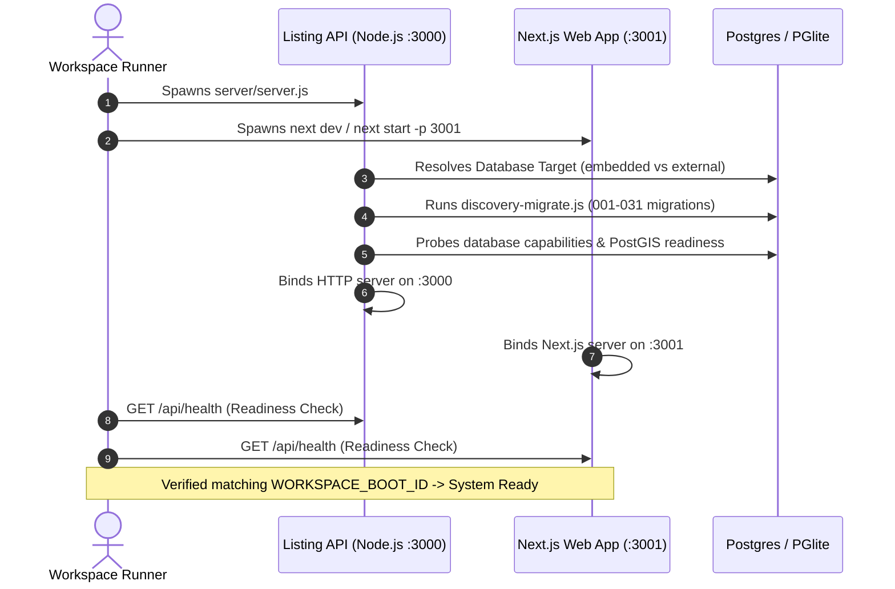
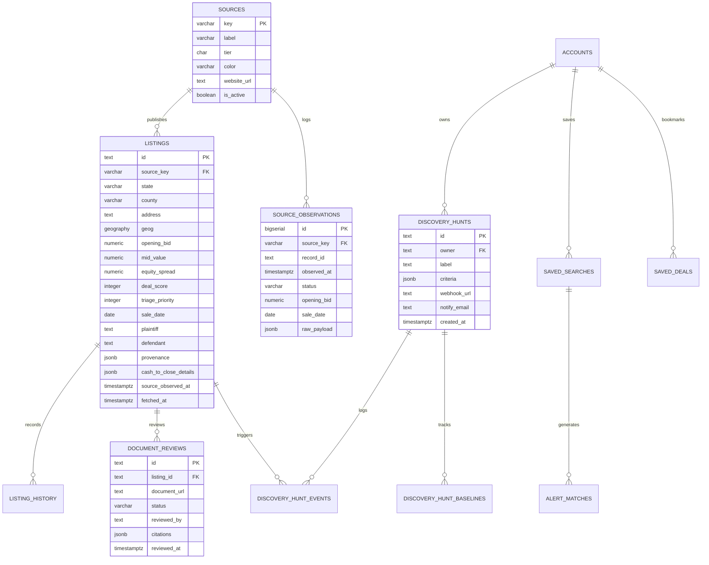

# Property-Crawl: System Architecture & Full-Stack Data Flow Specification

> **Document Version:** 2.0.0  
> **Status:** Authoritative Architecture Reference  
> **Target Environment:** Node.js >=22.0.0, Next.js 16 (App Router), PostgreSQL 16+ / PostGIS (or in-process PGlite)  
> **Project Root:** `C:\Users\serge\.minimax\sessions\mvs_33469e4a8e48472faf25c6f55a29c489\workspace\property-crawl`  

---

## Table of Contents

1. [Executive Summary & Core Directives](#1-executive-summary--core-directives)
2. [Dual-Process Runtime Architecture](#2-dual-process-runtime-architecture)
3. [End-to-End Data Flow Pipeline](#3-end-to-end-data-flow-pipeline)
   - [3.1 Scraper Ingestion & Evidence Collection](#31-scraper-ingestion--evidence-collection)
   - [3.2 Validation, Normalization & Provenance Ledger](#32-validation-normalization--provenance-ledger)
   - [3.3 Database Storage & Persistence Models](#33-database-storage--persistence-models)
   - [3.4 Canonical API Layer (Node.js Port 3000)](#34-canonical-api-layer-nodejs-port-3000)
   - [3.5 Gateway Proxy & Security Layer (Next.js Port 3001)](#35-gateway-proxy--security-layer-nextjs-port-3001)
   - [3.6 Frontend User Interface & Underwriting Surfaces](#36-frontend-user-interface--underwriting-surfaces)
4. [Component Hierarchy & Client State Management](#4-component-hierarchy--client-state-management)
5. [API Contracts & Payload Specifications](#5-api-contracts--payload-specifications)
6. [Database Schema & Migration Ledger](#6-database-schema--migration-ledger)
7. [External Integrations & GIS Enrichment Engines](#7-external-integrations--gis-enrichment-engines)
8. [Comprehensive File System Map](#8-comprehensive-file-system-map)

---

## 1. Executive Summary & Core Directives

**Property-Crawl** is an evidence-first discovery and underwriting intelligence workspace specifically engineered for distressed real estate (foreclosures, tax sales, sheriff auctions, and government-sold properties from HUD, USDA, Treasury, GSA, and IRS).

### Core Architectural Principles:
1. **Zero-Fabrication / Evidence-First Discipline:** No derived assumption is ever presented as a verified public record. If a redemption window, senior debt, or opening bid is unknown, it remains explicitly labeled as `unresolved` or `unknown`, rather than defaulting to zero or fabricating market averages.
2. **Dual-Runtime Process Segregation:** Heavy scraper tasks, background intervals, real GIS calculations, and relational/spatial database management run on an Express-style native Node.js HTTP server (Port 3000). The Next.js 16 App Router application (Port 3001) acts as the secure presentation layer and reverse-proxy gateway.
3. **Dual-Engine Persistence:** The system operates natively on PostgreSQL with PostGIS in production, while maintaining zero-dependency local execution via `@electric-sql/pglite` (embedded WASM Postgres in-process) when `PROPERTY_DB=embedded`.
4. **Append-Only Evidence Ledger:** Every observed publisher record generates an immutable SHA-256 payload snapshot and a verifiable ledger block before normalization and persistence.
5. **Character-Span Citation Verification:** Legal notices and court dockets are parsed with character-span citations (`start`, `end`, and exact excerpt), allowing human reviewers to verify fine-print facts against raw notices in a split-pane interface.

```
┌─────────────────────────────────────────────────────────────────────────────────────────┐
│                                 PROPERTY-CRAWL TOPOLOGY                                 │
└─────────────────────────────────────────────────────────────────────────────────────────┘
        │
        ├─► [Port 3001] Next.js 16 App Router (UI & Gateway Proxy)
        │     ├─► Server-Side Rendering (SSR) & Dynamic Route Handlers
        │     ├─► Content Security Policy (CSP Nonce Injection)
        │     ├─► Session Authorization (Workspace Operator & Member Auth)
        │     └─► Reverse Proxies (/api/*) to Upstream Port 3000
        │
        ├─► [Port 3000] Canonical Listing & Intelligence API (Node.js HTTP Server)
        │     ├─► Ingestion Scheduler & Concurrency Worker (MapWithConcurrency)
        │     ├─► Source Adapters (HUD, Treasury, USDA, IRS, CivilView, ServiceLink, etc.)
        │     ├─► Anti-Bot Toolchain (Zyte Client, Scrapling Bridge, Circuit Breakers)
        │     ├─► Title Risk Engine & Adversarial Trial Docket
        │     ├─► Underwriting & Cash-to-Close Engine
        │     └─► GIS / Cadastral Boundary Engines (ArcGIS REST, FEMA, EPA, USGS)
        │
        └─► Persistence Engine
              ├─► Production: PostgreSQL 16+ with PostGIS Extension
              └─► Local / Isolated: Embedded PGlite (WASM Postgres Engine on Disk)
```

---

## 2. Dual-Process Runtime Architecture

The workspace utilizes `scripts/workspace-runner.js` to supervise and boot both runtime environments under a shared process boot token (`WORKSPACE_BOOT_ID`), ensuring graceful startup, unified logs, and simultaneous shutdown.



### Process Roles:
1. **Listing Server (`server/server.js` - Port 3000):**
   - Pure Node.js `http.createServer` decorated with Express-like helpers (`res.json`, `res.status`, `res.send`).
   - Directly executes database connection pooling via `pg.Pool` or `@electric-sql/pglite`.
   - Runs `scrapers/scheduler.js` in background cycles (default 6h cadence) with configurable concurrency and lease-fencing.
   - Enforces strict Origin checking against `CORS_ALLOWED_ORIGINS` and `PUBLIC_APP_ORIGIN`.
   - Protects sensitive operations via `createApiRatePolicy` (sliding-window IP limiter).

2. **Web Application (`src/` - Port 3001):**
   - Next.js 16 App Router using React 19 Server Components and dynamic client components.
   - Handles route matching, pre-fetching, dynamic layouts, and static optimization.
   - `middleware.ts` / `src/proxy.ts` computes and injects a cryptographic per-request `nonce` for strict Content Security Policy (blocking `unsafe-inline` scripts).
   - `src/lib/property-api.ts` provides a secure, streaming forwarder that enforces request size bounds (2MB payload, 8KB URL), origin identity, and session authentication.

---

## 3. End-to-End Data Flow Pipeline

The end-to-end data lifecycle traverses six distinct stages, ensuring raw public data is transformed into actionable, evidence-verified investment underwriting.

```mermaid
flowchart TD
    subgraph INTAKE["1. INTAKE & SCRAPERS"]
        S1["Federal Portals<br/>(HUD, USDA, GSA, Treasury, IRS)"]
        S2["County Dockets<br/>(CivilView, Bid4Assets, Sheriff)"]
        S3["Email Ingest & CourtListener"]
        S4["Public Auction Network<br/>(ServiceLink)"]
    end

    subgraph ENGINE["2. ADAPTERS & NORMALIZATION"]
        A1["Fetch Strategy & Anti-Bot<br/>(Zyte, Scrapling, Auto-Throttle)"]
        A2["Validation Gate<br/>(validateListingForIngestion)"]
        A3["Selector Drift Alarm<br/>(evaluateRecordsForDrift)"]
        A4["Evidence Ledger Snapshot<br/>(recordSnapshot -> SHA256)"]
    end

    subgraph STORAGE["3. DATABASE / STORAGE"]
        DB1[("PostgreSQL / PostGIS<br/>(or Embedded PGlite)")]
        T_L["listings table"]
        T_O["source_observations"]
        T_S["discovery_snapshots"]
        T_H["discovery_hunts & events"]
        T_R["document_reviews"]
    end

    subgraph API["4. CANONICAL API (:3000)"]
        R1["/api/listings & /api/listings/map"]
        R2["/api/listings/:id/packet"]
        R3["/api/hunts & /api/hunts/:id/evaluate"]
        R4["/api/source-network & /api/coverage"]
        R5["/api/document-review & /api/federal-hazards"]
        R6["/api/health & /api/health/ready"]
    end

    subgraph GATEWAY["5. NEXT.JS GATEWAY (:3001)"]
        G1["proxyPropertyApi"]
        G2["proxyMemberPropertyApi"]
        G3["proxyPrivatePropertyApi"]
        G4["proxyWatchlistPropertyApi"]
    end

    subgraph UI["6. FRONTEND SURFACES"]
        U1["Discovery Workbench<br/>(Grid, Map, Triage Chips)"]
        U2["Property Dossier<br/>(Media, Comps, Assessor)"]
        U3["Bidding Simulator<br/>(Cash-to-Close, Carry, EV)"]
        U4["Adversarial Trial Docket<br/>(Prosecution vs Defense)"]
        U5["Document Reviewer<br/>(Character-Span Queue)"]
        U6["Source Radar<br/>(Coverage Matrix)"]
    end

    INTAKE --> ENGINE
    ENGINE --> STORAGE
    STORAGE --> API
    API --> GATEWAY
    GATEWAY --> UI
```



### 3.1 Scraper Ingestion & Evidence Collection
- **Source Taxonomy (`server/sources/catalog.js`):**
  Categorizes all sources into strict operational classes:
  - `VERIFIED_OFFICIAL`: First-party government publisher with confirmed live collector (e.g. `usda-resales`, `irs-auctions`, `treasury-forfeiture`, `gsa-real-estate-sales`).
  - `VERIFIED_FIRST_PARTY`: Commercial auction partner with confirmed collector (e.g. `servicelink`).
  - `SCOPE_LIMITED`: Verified collector operating over specific jurisdictions (e.g. `civilview`, `hud-homestore`, `cuyahoga-land-bank`).
  - `LOCAL_ROUTE`: Jurisdiction-specific legal auction channels requiring localized scrapers (e.g. `alachua-tax-deeds`, `ohio-sheriff-sale`, `harris-county-tax-sale`).
  - `DISCOVERY_ONLY`: Cataloged sources used for evidence screening, never admitting actionable listings without promotion (e.g. `fl-dor-cadastral`, `courtlistener`).
  - `INCONCLUSIVE_BLOCKED`: Anti-bot or CAPTCHA-blocked sources under remediation (e.g. `bid4assets`, `landbanksearch`).

- **Scheduler Execution (`server/scrapers/scheduler.js`):**
  - Concurrency management via `mapWithConcurrency(scrapers, concurrency, worker)`.
  - Job fencing and distributed leases via `discovery_leases` table to prevent race conditions during multi-instance execution.
  - Resumable checkpointing via `discovery_checkpoints` and scope hashes.
  - Adaptive request transport via `server/scrapers/fetch-strategy.js` supporting standard HTTPS, Zyte headless scraping, and Python-based Scrapling spiders.

### 3.2 Validation, Normalization & Provenance Ledger
- **Validation Gate (`server/scrapers/validation.js`):**
  Every scraped record is checked against `server/scrapers/listing.schema.json`. Must contain valid sourceKey, non-empty address, state code, numeric constraints, and publisher provenance.
- **Drift Alarm Engine (`server/scrapers/drift-alarm.js`):**
  Evaluates incoming batch distributions. If critical fields (such as `openingBid`, `saleDate`, `address`) drop significantly below historical norms, a drift alarm triggers to flag potential DOM selector changes.
- **Immutable Snapshotting (`server/scrapers/discovery-snapshots.js`):**
  Raw HTTP responses and publisher JSON payloads are SHA-256 hashed and recorded into `discovery_snapshots` and an append-only ledger block before any mapping logic modifies the data.
- **Longitudinal Tracking (`server/db/observations-persistence.js`):**
  Each run records an observation event in `source_observations`, recording price changes, postponement dates, cancellations, and status evolutions.

### 3.3 Database Storage & Persistence Models
- Listings are stored in the canonical `listings` table.
- Financial figures are stored as explicit `NUMERIC(14,2)`:
  - `opening_bid`, `est_low`, `est_high`, `assessed_value`, `judgment_amount`, `cash_to_close`.
  - Generated stored columns: `mid_value` = `(est_low + est_high) / 2.0` and `equity_spread` = `GREATEST(0, mid_value - opening_bid)`.
- Spatial data: `geog GEOGRAPHY(Point, 4326)` indexed with PostGIS GIST indexes for ultra-fast spatial bbox filtering.
- Full text search: GIN indexes over address, county, plaintiff, and defendant.
- Native aggregations: Materialized views (`mv_neighborhood_stats`) refreshed concurrently for neighborhood metrics.

### 3.4 Canonical API Layer (Node.js Port 3000)
- Exposes RESTful JSON endpoints.
- Decouples client queries from raw SQL via `DatabaseClient` (`server/db/client.js`).
- Implements custom query serialization and parsing (`server/discovery/query.js`).
- Evaluates real-time Deal Score (1-99), Triage Priority (0-99), and Research Quality (0-100).

### 3.5 Gateway Proxy & Security Layer (Next.js Port 3001)
- Thin Next.js Edge/Node Route Handlers in `src/app/api/...` delegate to `src/lib/property-api.ts`.
- Validates request URLs against `API_PATH` regex.
- Enforces strict same-origin or CORS allowlist rules.
- Translates client authorization:
  - Public requests: Sanitized and stripped of operator credentials.
  - Member requests: Signed session verified; account ID injected into `x-pp-account` header.
  - Operator requests: Validated via `pp_operator_session` cookie; token injected into `Authorization: Bearer` header.
  - Watchlist requests: Bound to anonymous `pp_watchlist` HttpOnly cookie or promoted to member account.

### 3.6 Frontend User Interface & Underwriting Surfaces
- Server Components perform initial SSR data fetch (`loadInitialListings`).
- Client Components mount reactive workbench widgets (`DiscoveryWorkbench`, `DiscoveryMap`, `BiddingSimulator`).
- Underwriting calculations run in pure TypeScript client modules (`src/lib/underwriting.ts`, `src/lib/redemption-ev.ts`) with zero round-trip latency during parameter adjustments.

---

## 4. Component Hierarchy & Client State Management

### 4.1 Component Architecture Tree

```
src/app/layout.tsx (Root HTML, CSP Nonce, Theme Provider)
│
├── src/app/page.tsx (Landing Page)
│     ├── SiteHeader, Hero, UnicornHeroBg
│     ├── DealDiscoveryMap (Deferred MapLibre preview)
│     ├── SecondLookShowcase, AiComparison, Storyteller
│     └── FinalCta, SiteFooter
│
├── src/app/listings/page.tsx (Primary Discovery Workbench)
│     └── WorkspaceShell (Operator session context)
│           ├── DataModeBanner (Shows live Postgres vs demo mode)
│           └── DiscoveryWorkbench
│                 ├── WorkbenchSearchInput (Stable keystroke barrier)
│                 ├── TriageChips (Distress category quick filters)
│                 ├── ViewSwitcher:
│                 │     ├── Grid/Cards View -> DiscoveryCard (48 per page)
│                 │     │     ├── ListingThumbnail (Panoramax / Street View / Photo)
│                 │     │     ├── ScoreBandBadge (Deal Score 1-99)
│                 │     │     └── ListingCompareToggle
│                 │     ├── Map View -> DiscoveryMap (MapLibre GL with BBox clusters)
│                 │     ├── Calendar View (Auction dates timeline)
│                 │     └── Table View (High-density financial matrix)
│                 ├── CompareTray (Docked bottom drawer for 2-4 listings)
│                 └── SaveSearchButton (Modal trigger for hunt alerts)
│
├── src/app/listings/[id]/page.tsx (Property Dossier & Due Diligence)
│     └── WorkspaceShell
│           ├── DossierHeader (Back link, Status badges, Exact Source URL)
│           ├── ListingMedia (Photo gallery, Street View, Mapillary, Panoramax)
│           ├── Fact & GapLedger (Evidence completeness & unresolved data)
│           ├── SaleMechanics (Opening bid, Deposit, Statutory timeline)
│           ├── PropertyIntelligence (Price drop history, Comps, Valuation bands)
│           ├── TitleRiskAssessment (Junior lien waterfall, Tax & HOA super liens)
│           ├── PropertyDocuments (Attached PDFs, Notices, Evidence tags)
│           ├── AssessorReading (Tax assessor valuation, Land use code, APN)
│           ├── EnrichmentView (FEMA flood zones, EPA hazards, USGS terrain, HUD rent)
│           ├── NearbyComps (Recent cadastral & recorder comparable sales)
│           ├── BiddingSimulator (Interactive underwriting & cash-to-close)
│           ├── Parcel3DVisualizer (GeoJSON cadastral polygon visualizer)
│           ├── AdversarialTrialDocket (Prosecution deal-killers vs Defense upside)
│           └── DecisionPacketView (Exportable executive investment memorandum)
│
├── src/app/hunts/page.tsx (Saved Searches & Hunt Radar)
│     ├── SavedHunts (Persistent query profiles)
│     ├── HuntEventsStream (Real-time new match & price change events)
│     └── WebhookConfigModal
│
├── src/app/research/page.tsx (Operator Research Workspace)
│     ├── ResearchInbox (Triage queue for incoming leads)
│     ├── ResearchCase (Detailed investigator casefile)
│     └── AlachuaSecondChance (Tax deed redemption analysis)
│
├── src/app/workspace/documents-review/page.tsx (Document Review Queue)
│     ├── DocumentReviewQueue (Filterable status queue: pending, in_review, accepted)
│     └── ReviewSplitPane (Side-by-side legal notice PDF/text + character-span editor)
│
└── src/app/sources/page.tsx (Source Radar & Coverage Matrix)
      ├── SourceAtlas (50-state statutory registry)
      └── SourceNetwork (Real-time telemetry, crawler health & scrapers status)
```

### 4.2 Client State Management Architecture

The frontend avoids monolithic global state stores in favor of a layered, purpose-driven state architecture:

1. **URL Search Parameter State (`src/lib/discovery-query.ts`):**
   - Single source of truth for discovery filters (`q`, `state`, `county`, `source`, `type`, `status`, `minScore`, `minEquity`, `maxBid`, `sort`, `view`).
   - Deep-linkable and bookmark-safe.
   - Normalized via `readDiscoveryFilters()` and serialized via `discoverySearchParams()`.
   - Client-side navigation updates the URL via `next/navigation` without full page refreshes.

2. **Terminal Filter Store (`src/lib/terminal-filter-store.ts`):**
   - Pure reducer (`terminalFilterReducer`) managing the interactive terminal filters.
   - Evaluates filter predicate matching across listings completely in memory when offline.

3. **Underwriting Scenario Local Storage (`src/lib/underwrite-scenario.ts`):**
   - Persists operator underwriting inputs (`rehabBudget`, `targetMargin`, `holdingMonths`, `customValuation`, `customOpeningBid`, `scenarioCash`) per listing in browser storage under key `pp_underwrite_scenario_<listingId>`.
   - Instantly hydrates the `BiddingSimulator`, `DecisionPacketView`, and `AdversarialTrialDocket`.

4. **Compare Tray Store (`src/lib/compare-selection.js`):**
   - Tracks selected property IDs (up to `COMPARE_LIMIT = 4`) for multi-card side-by-side analysis.
   - Synchronized across tabs and views.

5. **Session & Security State (`src/lib/workspace-session.ts`, `src/lib/member-account.ts`):**
   - `useWorkspaceSession()`: Exposes operator authentication status, unlock prompt modal trigger, and session token.
   - `pp_watchlist` cookie: Anonymous cookie storing favorited properties, auto-promoted to member account upon authentication.

---

## 5. API Contracts & Payload Specifications

### 5.1 Listing Search & Filtering (`GET /api/listings`)

**Request Parameters:**
```http
GET /api/listings?q=cleveland&state=OH&county=Cuyahoga&source=sheriff&minScore=70&maxBid=150000&sort=date&limit=50&offset=0 HTTP/1.1
Host: localhost:3000
Accept: application/json
```

| Parameter | Type | Default | Description |
|---|---|---|---|
| `q` | string | `""` | Search query matching address, plaintiff, defendant, attorney, or APN |
| `state` | string | `"all"` | 2-letter US state postal abbreviation (e.g. `OH`, `FL`, `TX`) |
| `county` | string | `"all"` | County name (e.g. `Cuyahoga`, `Alachua`) |
| `source` | string | `"all"` | Source key from catalog (`sheriff`, `hud`, `treasury`, etc.) |
| `type` | string | `"all"` | Property classification (`single_family`, `multi_family`, `condo`, `land`) |
| `status` | string | `"all"` | Canonical sale status (`active`, `scheduled`, `sold`, `postponed`, `cancelled`) |
| `occupancy`| string | `"all"` | Occupancy status (`vacant`, `occupied`, `unknown`) |
| `seniorLien` | string | `"all"` | Filter by senior lien risk (`clean`, `risk`) |
| `redemption` | string | `"all"` | Filter by statutory redemption (`immediate`, `redemption_active`) |
| `minScore` | integer | `0` | Minimum Deal Score threshold (1 to 99) |
| `minEquity`| integer | `0` | Minimum equity spread (dollars) |
| `maxBid` | integer | `0` | Maximum opening bid ceiling (dollars) |
| `minQuality` | integer | `0` | Minimum listing detail & research quality (0 to 100) |
| `sort` | string | `"score"` | Sort order: `score`, `quality`, `opportunity`, `triage`, `date`, `bid-asc`, `equity` |
| `limit` | integer | `50` | Page size (1 to 1,000) |
| `offset` | integer | `0` | Pagination offset |
| `format` | string | `"full"`| Output projection: `full` or `summary` |

**Response Payload (200 OK):**
```json
{
  "listings": [
    {
      "id": "SHERIFF-OH-CUY-10231",
      "source": "sheriff",
      "state": "OH",
      "county": "Cuyahoga",
      "city": "Cleveland",
      "zip": "44102",
      "address": "1248 W 76th St",
      "lat": 41.4875,
      "lng": -81.7289,
      "beds": 3,
      "baths": 1.5,
      "sqft": 1420,
      "year": 1910,
      "propType": "single_family",
      "openingBid": 45000.0,
      "estLow": 130000.0,
      "estHigh": 160000.0,
      "assessed": 98000.0,
      "mid": 145000.0,
      "ratio": 0.31,
      "equity": 100000.0,
      "bidSpread": 100000.0,
      "dealScore": 88,
      "saleDate": "2026-11-20",
      "plaintiff": "Fifth Third Bank",
      "defendant": "Estate of Eleanor Vance",
      "judgment": 62450.0,
      "attorney": "Manley Deas Kochalski LLC",
      "occupancy": "vacant",
      "deposit": "10% down at auction; balance in 30 days",
      "photo": "/api/property-image?listingId=SHERIFF-OH-CUY-10231",
      "images": ["https://images.example.com/cuyahoga/10231_1.jpg"],
      "sourceUrl": "https://salesweb.civilview.com/Sales/SaleDetails?PropertyId=10231",
      "status": "scheduled",
      "hasDocuments": true,
      "triagePriority": 85,
      "sourceFreshness": {
        "observedAt": "2026-11-08T18:00:00.000Z",
        "ageHours": 15.5,
        "cadenceHours": 24,
        "status": "current"
      },
      "parcelKey": "39035-002-14-082",
      "provenance": {
        "origin": "live",
        "observed": true,
        "recordKind": "source_record",
        "publisher": "Cuyahoga County Sheriff",
        "recordId": "10231",
        "observedAt": "2026-11-08T18:00:00.000Z"
      }
    }
  ],
  "total": 1420,
  "revision": "e3b0c44298fc1c149afbf4c8996fb92427ae41e4649b934ca495991b7852b855",
  "facets": {
    "state": [{ "value": "OH", "count": 482 }, { "value": "FL", "count": 315 }],
    "source": [{ "value": "sheriff", "count": 620 }, { "value": "hud", "count": 210 }]
  }
}
```

---

### 5.2 Single Property Dossier (`GET /api/listings/:id`)

**Request:**
```http
GET /api/listings/SHERIFF-OH-CUY-10231 HTTP/1.1
Host: localhost:3000
Accept: application/json
```

**Response Payload (200 OK):**
Includes complete property record plus cadastral matching, document evidence arrays, statutory redemption terms, senior lien risk audit, and assessor readings.

---

### 5.3 Underwriting Decision Packet (`GET /api/listings/:id/packet`)

**Request Parameters:**
- `format`: `json` (default) or `markdown`
- `disposition`: `BID` | `PASS` | `UNDERWRITE`
- `maxAllowableOffer`: number
- `operatorNotes`: string

**Response Payload (200 OK - JSON Mode):**
```json
{
  "packetId": "pkt_7f8a9b2c3d4e",
  "generatedAt": "2026-11-09T09:45:00.000Z",
  "property": {
    "id": "SHERIFF-OH-CUY-10231",
    "address": "1248 W 76th St, Cleveland, OH 44102",
    "county": "Cuyahoga",
    "state": "OH",
    "openingBid": 45000.0,
    "saleDate": "2026-11-20"
  },
  "underwriting": {
    "cashToClose": {
      "model": "explicit-cash-requirements-v2",
      "totalAcquisitionCost": 51200.0,
      "registrationFunds": 5000.0,
      "creditedDeposit": 4500.0,
      "buyersPremium": 0.0,
      "sheriffPoundage": 1200.0,
      "transferTax": 500.0,
      "delinquentTaxes": 0.0,
      "settlementCosts": 0.0,
      "cashDueAtSettlement": 46700.0
    },
    "titleRisk": {
      "compositeRisk": "low",
      "seniorLienRisk": "clean",
      "statutoryRedemptionDays": 0,
      "hasIrsTaxLien": false,
      "hasMunicipalCodeViolations": false,
      "hasBankruptcyStay": false
    },
    "statutoryDeadlinesAndCarry": {
      "confirmationDays": 30,
      "deedDeliveryDays": 45,
      "estimatedHoldingMonths": 6,
      "monthlyCarryCost": 350.0,
      "totalCarryCost": 2100.0
    }
  },
  "adversarialDocket": {
    "prosecution": [
      { "tag": "Age", "severity": "medium", "detail": "Built in 1910; structural and plumbing inspection required." }
    ],
    "defense": [
      { "tag": "Equity", "strength": "strong", "detail": "69% discount to middle valuation; $100,000 gross equity spread." },
      { "tag": "Clean Title", "strength": "strong", "detail": "First mortgage foreclosure; junior liens extinguished upon confirmation." }
    ]
  },
  "dispositionSignOff": {
    "recommendation": "BID",
    "maxAllowableOffer": 75000.0,
    "approvedBy": "operator"
  }
}
```

---

### 5.4 Saved Hunts & Continuous Radar (`POST /api/hunts` & `POST /api/hunts/:id/evaluate`)

**Create Hunt Request:**
```http
POST /api/hunts HTTP/1.1
Host: localhost:3000
Content-Type: application/json
Authorization: Bearer <SCRAPER_ADMIN_TOKEN>

{
  "label": "Cuyahoga Sheriff Deals <$60k",
  "criteria": {
    "states": ["OH"],
    "counties": ["Cuyahoga"],
    "sources": ["sheriff"],
    "maxOpeningBid": 60000,
    "minDealScore": 75
  },
  "webhookUrl": "https://api.acme-investments.com/webhooks/deals",
  "notifyEmail": "acquisitions@acme-investments.com"
}
```

**Evaluate Hunt Request (`POST /api/hunts/:id/evaluate`):**
Runs the hunt criteria against the live database inventory, calculates baseline deltas, records `new_match`, `price_drop`, or `status_change` events in `discovery_hunt_events`, and triggers webhook/email digests.

---

### 5.5 GIS Parcel Boundary (`GET /api/parcel-boundary`)

**Request:**
```http
GET /api/parcel-boundary?state=OH&county=Cuyahoga&apn=002-14-082&lat=41.4875&lng=-81.7289 HTTP/1.1
Host: localhost:3000
Accept: application/json
```

**Response Payload (200 OK - GeoJSON Feature):**
```json
{
  "type": "Feature",
  "geometry": {
    "type": "Polygon",
    "coordinates": [
      [
        [-81.72912, 41.48765],
        [-81.72875, 41.48765],
        [-81.72875, 41.48735],
        [-81.72912, 41.48735],
        [-81.72912, 41.48765]
      ]
    ]
  },
  "properties": {
    "parcelId": "002-14-082",
    "lotSqft": 4800,
    "lotAcres": 0.11,
    "perimeterFt": 280,
    "frontageFt": 40.0,
    "depthFt": 120.0,
    "zoning": "2F - Two Family Residential",
    "source": "arcgis_rest",
    "sourceName": "Ohio Geographically Referenced Information Program (OGRIP)",
    "evidenceStatus": "source_observed",
    "surveyStatus": "not_a_survey",
    "disclaimer": "Cadastral reference only — not a boundary survey"
  }
}
```

---

### 5.6 Federal Environmental & Physical Hazards (`GET /api/federal-hazards`)

**Request:**
```http
GET /api/federal-hazards?lat=41.4875&lng=-81.7289 HTTP/1.1
Host: localhost:3000
Accept: application/json
```

**Response Payload (200 OK):**
```json
{
  "status": "success",
  "location": { "lat": 41.4875, "lng": -81.7289 },
  "flood": {
    "floodZone": "X",
    "floodRisk": "minimal",
    "sfha": false,
    "baseFloodElevation": null,
    "source": "FEMA National Flood Hazard Layer (NFHL)"
  },
  "environmental": {
    "superfundSiteWithin1Mile": false,
    "brownfieldWithin1000Ft": false,
    "triFacilityNearby": false,
    "source": "EPA Cleanups in My Community / TRI"
  },
  "topography": {
    "elevationMeters": 198.5,
    "slopeDegree": 1.2,
    "terrain": "level",
    "source": "USGS 3D Elevation Program (3DEP)"
  },
  "insuranceUnderwriting": {
    "recommendedAnnualFloodReserve": 0.0,
    "requiresMandatoryFloodInsurance": false
  }
}
```

---

### 5.7 System Health & Inventory Freshness (`GET /api/health` & `GET /api/health/ready`)

**Response Payload (200 OK):**
```json
{
  "status": "ok",
  "uptime": 14285.4,
  "timestamp": "2026-11-09T09:46:00.000Z",
  "dataMode": "postgres",
  "postgresConfigured": true,
  "postgresReachable": true,
  "databaseFunctional": true,
  "postgresEngine": "PostgreSQL 16.2 on x86_64, PostGIS 3.4.2",
  "collection": {
    "enabled": true,
    "reason": "enabled",
    "running": false,
    "startedAt": "2026-11-09T06:00:00.000Z",
    "lastFinishedAt": "2026-11-09T06:14:22.000Z",
    "scraperStatus": "healthy",
    "scrapersSeen": 24,
    "scrapersInFault": 0
  },
  "inventoryFreshness": {
    "totalRecords": 14205,
    "currentRecords": 12840,
    "staleRecords": 1365,
    "oldestObservedHours": 48.2,
    "newestObservedHours": 0.4
  },
  "observationStore": {
    "store": "postgres",
    "trackedRecords": 14205,
    "totalObservationEvents": 89420,
    "tableSizeBytes": 45875200
  }
}
```

---

## 6. Database Schema & Migration Ledger

The persistent relational schema is structured across 31 sequential, idempotent migrations:



### Key Migration Milestones:
- `001-005`: Base schemas, source seeds, cash detail JSONB bounds, and ServiceLink source admission.
- `006-014`: Discovery Brain architecture, snapshot compaction, distributed worker leases, and promotion evidence.
- `015-022`: Canonical status contracts, raw publisher payload isolation (nullable without fallback), party names widening (`TEXT`), and listing ID widenings.
- `023-024`: PostGIS spatial indexes (`GEOGRAPHY(Point, 4326)`), composite financial indexes (`(opening_bid, deal_score, sale_date)`), and materialized views (`mv_neighborhood_stats`).
- `025-027`: Longitudinal observation persistence (`source_observations` and `source_observation_runs`) migrating observation history into Postgres.
- `028-031`: Hunt notification email channels, member accounts schema (`accounts`, `account_login_tokens`, Stripe webhooks), and occupancy text fields.

---

## 7. External Integrations & GIS Enrichment Engines

```
┌────────────────────────────────────────────────────────────────────────┐
│                        EXTERNAL SERVICE MATRIX                         │
└────────────────────────────────────────────────────────────────────────┘
  SERVICE               PROTOCOL      ROLE & INTEGRATION POINT
──────────────────────────────────────────────────────────────────────────
  County ArcGIS REST    HTTPS JSON    Real cadastral parcel boundaries
                                      (OH OGRIP, FL FDEP, TX StratMap, NJGIN)
  US Census Bureau      REST API      Federal geocoder for address-to-lat/lng
  FEMA NFHL             OGC / REST    Flood zone X/A/AE determination & BFE
  EPA Envirofacts       REST API      Superfund, Brownfields & TRI sites
  USGS 3DEP             REST API      Elevation, slope and terrain grading
  HUD SAFMR             Static JSON   Small Area Fair Market Rent benchmarks
  FHFA HPI Series       Static JSON   House Price Index historical appreciation
  Panoramax             STAC / API    Decentralized open street-level imagery
  Mapillary             Vector / API  Secondary street-level inspection
  Zyte Headless Proxy   HTTP CONNECT  Headless anti-bot bypass for locked portals
  Stripe Billing        Webhooks      Member subscriptions & operator tiers
  Resend                HTTPS API     Outbound alert digests & login magic links
```

---

## 8. Comprehensive File System Map

```
property-crawl/
├── server/                                   # Native Node.js API Server (Port 3000)
│   ├── server.js                             # HTTP server entrypoint, routing, rate limiting & health
│   ├── discovery-readiness.js                # Database & discovery readiness probes
│   ├── state-codes.js                        # 50-state FIPS and postal lookup
│   ├── accounts/                             # Member account storage & session management
│   ├── ai/                                   # AI notice parsing & bidding strategy
│   │   ├── notice-parser.js                  # Regex and LLM legal notice parser
│   │   ├── bidding-simulator.js              # Auction bidding recommendation engine
│   │   ├── address-normalizer.js             # Address sanitization & USPS standards
│   │   ├── cache.js                          # AI response cache
│   │   ├── legal-rules.js                    # Statutory rules per jurisdiction
│   │   └── model_router.js                   # LLM fallback routing (local/cloud)
│   ├── db/                                   # Persistence layer
│   │   ├── client.js                         # DatabaseClient singleton (PG & PGlite)
│   │   ├── schema.sql                        # Production schema with PostGIS
│   │   ├── pglite-pool.js                    # In-process embedded Postgres launcher
│   │   ├── database-target.js                # Target resolver (embedded vs external)
│   │   ├── database-capabilities.js          # Probes Postgres & PostGIS feature support
│   │   ├── observations-persistence.js       # Longitudinal observation store
│   │   ├── listing-lifecycle.js              # State transitions (scheduled -> sold)
│   │   ├── listings-scan.js                  # Cursor & streaming whole-store queries
│   │   ├── property-media-store.js           # Photo and street-view cache
│   │   └── migrations/                       # 001-031 SQL migration scripts
│   ├── discovery/                            # Discovery engine & worker coordination
│   │   ├── store.js                          # DiscoveryStore data manager
│   │   ├── hunt-store.js                     # Persistent hunt storage (PG & File)
│   │   ├── job-fence.js                      # Distributed lease fences
│   │   ├── evidence-ledger.js                # Append-only SHA-256 block ledger
│   │   ├── storage-health.js                 # Disk space & DB capacity monitor
│   │   └── query.js                          # Canonical discovery query parser
│   ├── enrichment/                           # GIS & Environmental enrichment
│   │   ├── arcgis-parcels.js                 # County ArcGIS REST boundary resolver
│   │   ├── federal-hazards.js                # FEMA flood, EPA hazard & USGS terrain
│   │   ├── assessor-reading.js               # Tax assessor record interpreter
│   │   ├── local-parcel-index.js             # High-speed local cadastral index
│   │   ├── geocoder.js                       # US Census & GIS geocoding
│   │   └── hud-safmr.js                      # Fair Market Rent benchmarks
│   ├── export/                               # Document export generators
│   │   └── decision-packet.js                # Executive underwriting packet compiler
│   ├── intelligence/                         # Title risk, underwriting & alerts
│   │   ├── title-risk-engine.js              # Junior lien risk & priority arbiter
│   │   ├── surplus-waterfall.js              # Foreclosure surplus equity waterfall
│   │   ├── cash-to-close.js                  # Explicit cash-to-close calculations
│   │   ├── document-review.js                # Document review state machine
│   │   ├── document-review-store.js          # Document review persistence
│   │   ├── adversarial-trial-docket.js       # Prosecution vs Defense evaluation
│   │   ├── auction-calendar.js               # Native auction calendar aggregator
│   │   └── hunts.js                          # Hunt criteria evaluator
│   ├── routes/                               # HTTP Route Handlers
│   │   ├── listings.js                       # GET /api/listings & /api/listings/:id
│   │   ├── decision-packet.js                # GET/POST /api/listings/:id/packet
│   │   ├── hunts.js                          # GET/POST/PATCH /api/hunts/*
│   │   ├── saved-searches.js                 # CRUD /api/saved-searches & alert matches
│   │   ├── source-network.js                 # GET /api/source-network & worker jobs
│   │   ├── document-review.js                # GET/POST /api/document-review/*
│   │   ├── parcel-boundary.js                # GET /api/parcel-boundary
│   │   ├── federal-hazards.js                # GET /api/federal-hazards
│   │   ├── property-image.js                 # GET /api/property-image
│   │   ├── parse.js                          # POST /api/parse (AI notice parsing)
│   │   └── export.js                         # GET /api/export (Streaming CSV/JSON)
│   ├── scrapers/                             # Auction collectors & anti-bot adapters
│   │   ├── scheduler.js                      # Scheduled background worker
│   │   ├── fetch-strategy.js                 # HTTP, Zyte & Scrapling request manager
│   │   ├── drift-alarm.js                    # DOM drift detector
│   │   ├── discovery-snapshots.js            # Immutable snapshot recorder
│   │   ├── validation.js                     # Schema validation gate
│   │   ├── hud.js, treasury.js, irs.js       # Federal auction collectors
│   │   ├── civilview.js, servicelink.js      # County & platform collectors
│   │   └── adapters/                         # Local county clerk & recorder adapters
│   ├── security/                             # Security policies & sanitization
│   │   ├── api-rate-policy.js                # Sliding-window rate limiter
│   │   ├── workspace-identity.js             # Operator & member auth verification
│   │   ├── operator-token.js                 # Token matching & secrets check
│   │   └── sanitizer.js                      # HTML & input sanitization
│   └── sources/                              # Statutory catalog & source network
│       ├── catalog.js                        # Master source registry & status taxonomy
│       ├── nationwide-us-catalog.js          # 50-state source definitions
│       └── network.js                        # Source network graph builder
│
├── src/                                      # Next.js 16 Web Application (Port 3001)
│   ├── middleware.ts                         # Root middleware (CSP Nonce Generator)
│   ├── proxy.ts                              # Per-request CSP header injector
│   ├── app/                                  # App Router pages & API routes
│   │   ├── layout.tsx                        # Root layout with NonceContext
│   │   ├── page.tsx                          # Landing page
│   │   ├── listings/                         # Property listings explorer
│   │   │   ├── page.tsx                      # Discovery workbench page
│   │   │   └── [id]/page.tsx                 # Single listing dossier
│   │   ├── hunts/page.tsx                    # Persistent hunts dashboard
│   │   ├── research/page.tsx                 # Due diligence case workspace
│   │   ├── workspace/                        # Operator administration workspace
│   │   │   └── documents-review/page.tsx     # Character-span legal review queue
│   │   ├── sources/page.tsx                  # Statutory Source Radar
│   │   └── api/                              # Gateway Proxy Routes
│   │       ├── listings/route.ts             # Proxies /api/listings
│   │       ├── hunts/route.ts                # Proxies /api/hunts (Member auth)
│   │       ├── alerts/route.ts               # Proxies /api/alerts
│   │       ├── saved-searches/route.ts       # Proxies /api/saved-searches
│   │       ├── document-review/route.ts      # Proxies /api/document-review (Operator)
│   │       ├── federal-hazards/route.ts      # Proxies /api/federal-hazards
│   │       ├── parcel-boundary/route.ts      # Proxies /api/parcel-boundary
│   │       └── health/route.ts               # Proxies /api/health
│   ├── components/                           # UI Component Library
│   │   ├── listings/                         # Discovery cards, map, workbench, comps
│   │   ├── terminal/                         # Bidding simulator, docket, 3D parcel
│   │   ├── research/                         # Decision packet view, case manager
│   │   ├── workspace/                        # Operator review split-pane, shell
│   │   ├── documents/                        # Review queue components
│   │   ├── sources/                          # Source atlas & coverage visualizers
│   │   └── ui/                               # Radix UI primitives & design tokens
│   └── lib/                                  # Client utilities & underwriting logic
│       ├── property-api.ts                   # Gateway proxy transport
│       ├── workspace-proxy.ts                # Role-gated proxy helpers
│       ├── underwriting.ts                   # Financial & carry formulas
│       ├── redemption-ev.ts                  # Expected value Monte Carlo formulas
│       ├── adversarial-docket.ts             # Legal risk evaluation rules
│       ├── discovery-query.ts                # URL query serialization & facets
│       ├── terminal-filter-store.ts          # Terminal state reducer
│       └── underwrite-scenario.ts            # LocalStorage scenario persistence
│
├── floorplan/                                # Interactive Architecture Map & Graph
│   ├── architecture.json                     # Architecture nodes, edges & flow graph
│   └── index.html                            # Visual floorplan explorer
│
├── scripts/                                  # DevOps, migration & automation tools
│   ├── workspace-runner.js                   # Dual-process launcher & health supervisor
│   ├── discovery-migrate.js                  # Database migration executor
│   ├── start-production.js                  # Production entrypoint
│   └── release-gate.js                       # Comprehensive verification gate
│
└── package.json                              # Project manifest & npm lifecycle scripts
```

---

## 9. Verification & Architectural Guardrails

1. **API Parity Contract:** Any modification to Express routes in `server/routes/` MUST be reflected in `src/lib/property-api.ts`'s `API_PATH` regex; otherwise, Next.js gateway proxies will reject valid requests with 404s.
2. **Database Nonce Injection:** All client navigations MUST be signed with `x-nonce` via `src/proxy.ts` to satisfy browser CSP directives.
3. **No Unevidenced Defaults:** Underwriting algorithms in `src/lib/underwriting.ts` and `server/intelligence/cash-to-close.js` MUST return explicit `missingInputs` and `status: "unresolved"` rather than defaulting missing senior debt, delinquent taxes, or redemption costs to zero.
4. **Isolated Schema Migrations:** All schema updates MUST be authored as incremental numeric `.sql` files in `server/db/migrations/` and registered with both `server/db/schema.sql` and the embedded PGlite test suite.
