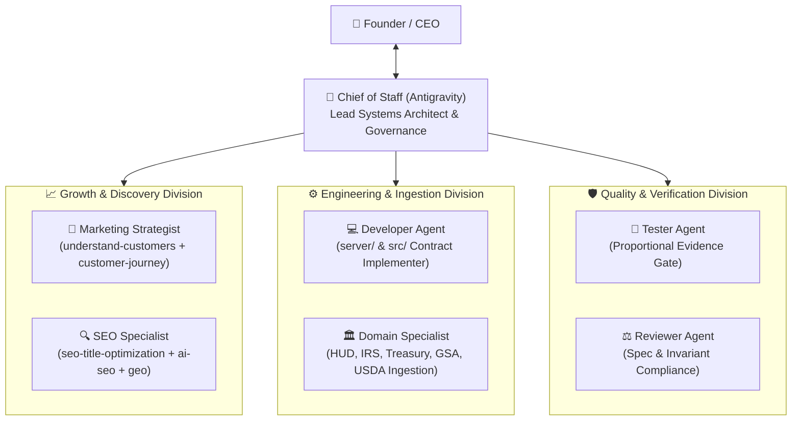

# Agent Team Roster: Chief of Staff & Specialist Divisions

> **Operating Standard:** Chief of Staff Mode — "Rulings, Not Stalls".  
> **Autonomous Authority:** Dispatches native subagents and swarm strategies without technical badgering.

---

## 🏛️ Organizational Hierarchy



---

## 👥 Roster & Skill Bindings

### 1. Growth & Discovery Division

#### `marketing-strategist`
- **Role**: Audience Empathy, Buyer Journey & Blitz Copy Strategist.
- **Playbook**: [.kilo/agent/marketing-strategist.md](file:///c:/Users/serge/.minimax/sessions/mvs_33469e4a8e48472faf25c6f55a29c489/workspace/property-crawl/.kilo/agent/marketing-strategist.md)
- **Bound Skills**:
  - `understand-customers` — Deep extraction of customer nightmare scenarios, unspoken desires, inner monologue, and emotional stakes.
  - `customer-journey` — 5-stage awareness journey mapping across Google, AI chatbots (ChatGPT, Claude, Perplexity), and social platforms.
  - `positioning-icp` — Ideal customer profile definition, unfair advantage articulation.
- **Capabilities**: `synthesize_customer_empathy`, `map_customer_journey`, `generate_growth_campaign`.

#### `seo-specialist`
- **Role**: Director of Organic & Agentic Search.
- **Playbook**: [.kilo/agent/seo-specialist.md](file:///c:/Users/serge/.minimax/sessions/mvs_33469e4a8e48472faf25c6f55a29c489/workspace/property-crawl/.kilo/agent/seo-specialist.md)
- **Bound Skills**:
  - `seo-title-optimization` — SERP-matched title rewriting, H1/title/meta alignment, 40-55 character boundaries, CTR formulas (`Primary keyword + modifier / benefit + brand`).
  - `geo-content-optimizer` — Generative Engine Optimization for Perplexity, ChatGPT Search, and Google AI Overviews.
  - `meta-tags-optimizer` — Structured OpenGraph, Twitter cards, and JSON-LD schema markup.
- **Capabilities**: `map_customer_journey`, `optimize_seo_titles_and_serp`, `generate_growth_campaign`, `verify_completion_gate`.

---

## ⚡ Execution Commands

```bash
# Swarm Execution
node scripts/swarm.js "audit customer journey and optimize page titles" --strategy=seo
node scripts/swarm.js "synthesize customer empathy and generate Blitz Copy" --strategy=growth

# Capability Graph Plan Compilation
node scripts/capability-graph.js --plan=growth_campaign_dossier
node scripts/capability-graph.js --check
```
